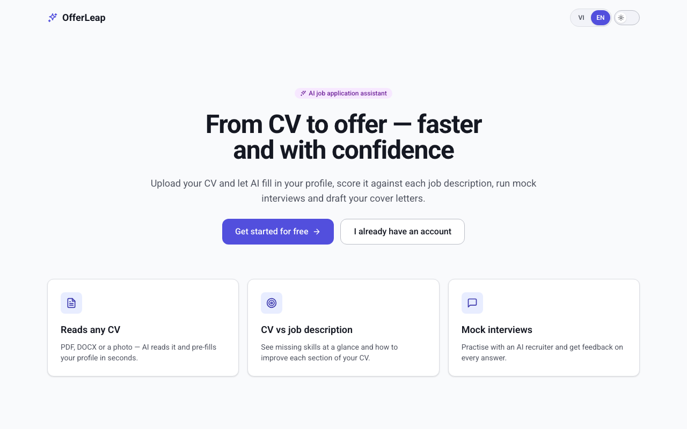
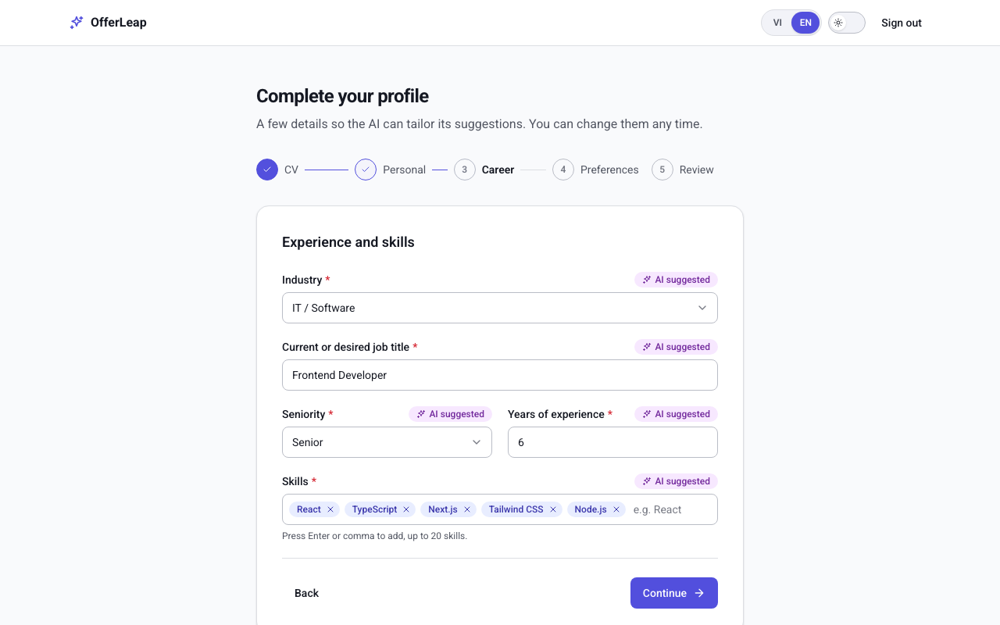
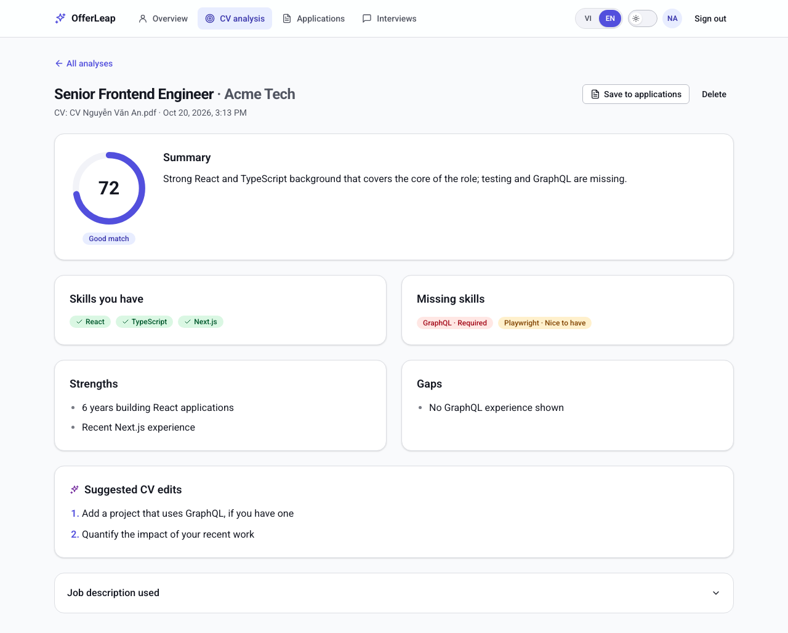
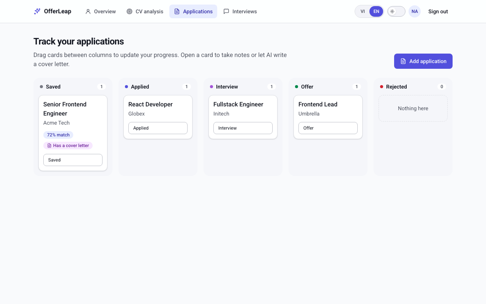
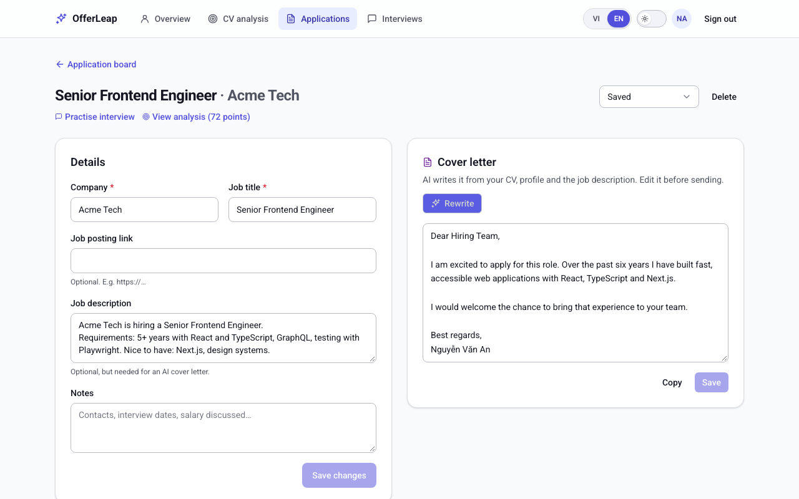
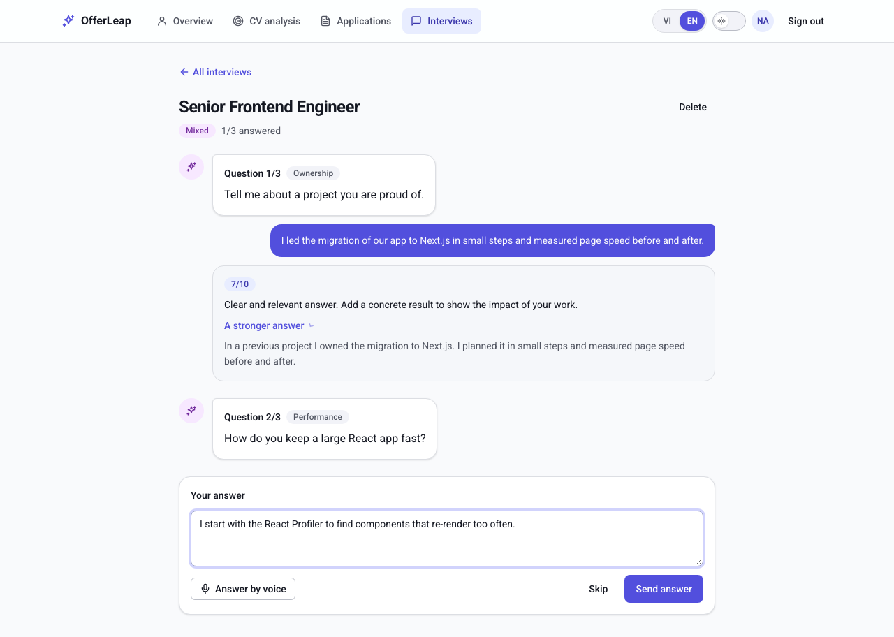
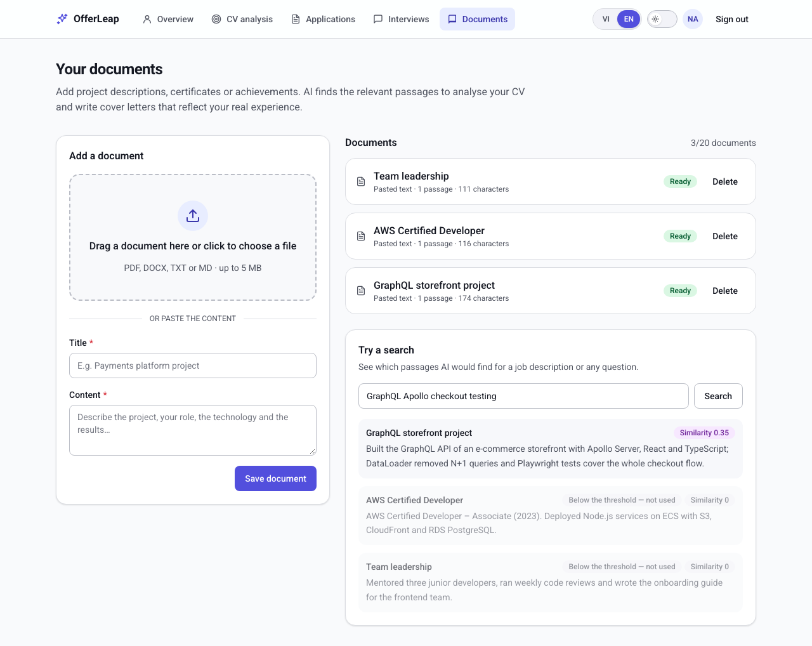
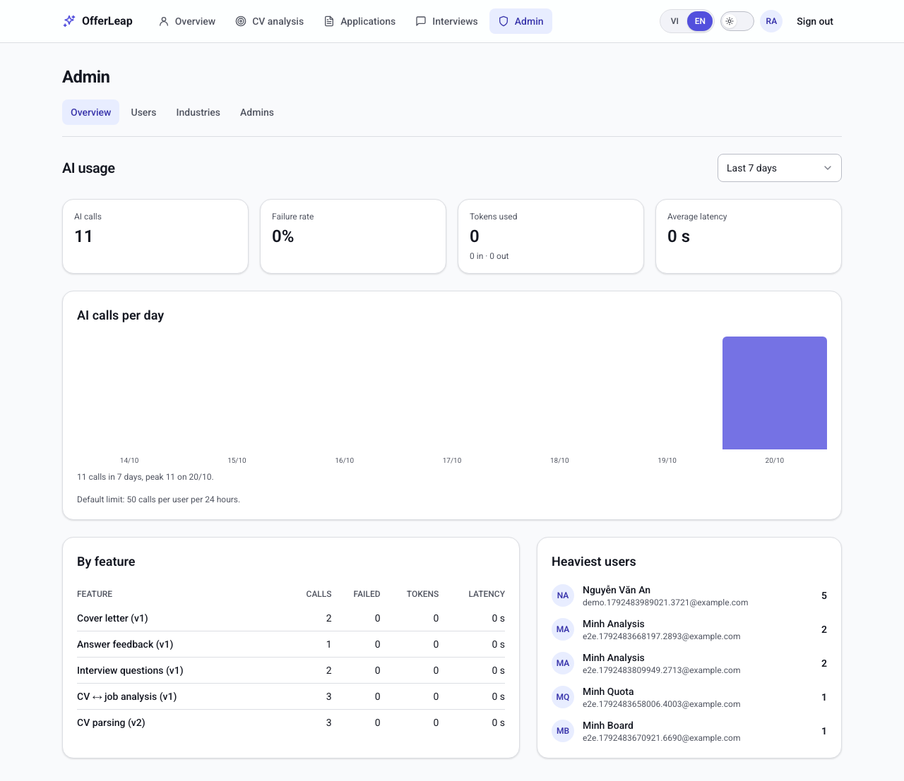
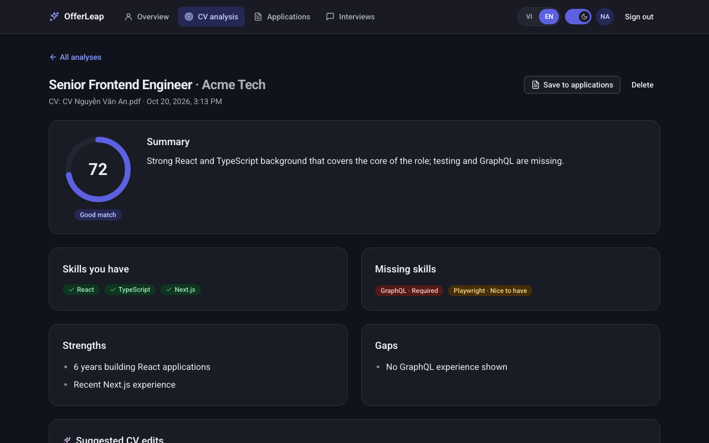
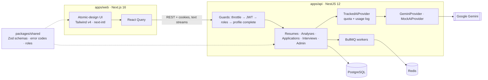

# OfferLeap

**Make the Leap. Land the Offer.**

OfferLeap is an AI job-application assistant. Upload your CV (PDF, DOCX or a photo) and the AI fills in your profile,
scores your CV against any job description, writes cover letters live, and runs mock interviews with feedback on
every answer — in Vietnamese or English, light or dark.



## Features

|                                                                                                                                                                                                                                                                            |                                                                        |
| -------------------------------------------------------------------------------------------------------------------------------------------------------------------------------------------------------------------------------------------------------------------------- | ---------------------------------------------------------------------- |
| **CV → profile in seconds.** Onboarding starts with an optional CV upload; Gemini reads PDFs and images natively (no OCR service), DOCX is parsed locally. Every field it fills is marked _AI suggested_, and guesses ask you to double-check.                             |  |
| **CV ↔ job analysis.** A 0–100 match score, skills you have and the ones missing (required vs nice-to-have), strengths, gaps and concrete CV edits.                                                                                                                        |                    |
| **Application board.** A kanban with drag and drop (and a keyboard/touch alternative), optimistic updates, notes and links to the analysis.                                                                                                                                |                          |
| **Cover letters, streamed.** The letter appears word by word as the model writes it; edit, copy and save.                                                                                                                                                                  |                   |
| **Mock interviews.** Behavioural or technical questions written for the job, a score and a stronger sample answer for each reply, voice input, and a final readiness summary.                                                                                              |                    |
| **Personal documents (RAG).** Upload project notes or certificates; they are chunked, embedded (Gemini) and stored in pgvector. Analyses and cover letters retrieve the most relevant passages and cite them as sources; a search box shows exactly what the AI would get. |                         |
| **Admin console.** Root invites general admins by email; admins manage users, industries and per-user AI quotas, and watch AI usage (calls, failures, tokens, latency).                                                                                                    |              |

Dark mode, Vietnamese (default) and English everywhere:



## Architecture



- **One contract, two apps.** Zod schemas, error codes and role rules live in `packages/shared`: the API validates
  with them and generates Swagger from them, the web app validates forms with the very same rules and translates
  error codes. The API never sends user-facing text.
- **AI behind an interface.** Features call an `AiProvider` (Strategy); a decorator adds per-user quotas and a usage
  log; the vendor (Gemini, or a mock for tests) is one class. Model fallback handles 429/503/timeouts.
- **Slow work in the background, fast work in the request.** CV parsing and analyses run in BullMQ jobs with retry
  and backoff (the UI polls); interview steps call the AI inside the request; cover letters stream over HTTP.

More: [architecture](docs/ai/architecture.md) · [decisions (ADRs)](docs/adr) · [AI prompts, evals and cost](docs/ai/ai-prompts.md)

## Engineering highlights

- **Security** — argon2id passwords, short-lived JWT access cookie + rotating opaque refresh tokens with reuse
  detection, rate limits, magic-byte file checks, owner-scoped queries (404 for other users' data), prompts that
  treat CVs and job descriptions as untrusted data, hashed single-use admin invitation tokens, a JSON
  export of your data and password-confirmed account deletion.
- **Accessibility** — native elements first (`<dialog>`, `<select>`, file input in a label), WAI-ARIA combobox,
  focus management between steps, live regions for async results, keyboard alternative to drag and drop.
- **AI quality is measured** — `pnpm --filter @offerleap/api eval <task>` runs a dataset of hard cases (abbreviations,
  overlapping jobs, missing data, prompt injection) against the real model and reports field accuracy and p95
  latency. Baseline: 100% field accuracy, p95 2.8 s for CV extraction. The eval found two real bugs.
- **No UI library** — every component (atoms → templates) is built with Tailwind and design tokens, documented in
  Storybook with light/dark and language toolbars.

## Tech stack

| Area    | Tech                                                                                          |
| ------- | --------------------------------------------------------------------------------------------- |
| Web     | Next.js 16 (App Router), React 19, Tailwind CSS v4, next-intl, React Query, React Hook Form   |
| API     | NestJS 12, Prisma 7, PostgreSQL 17, BullMQ + Redis, Nodemailer, Swagger                       |
| AI      | Google Gemini (`@google/genai`): structured JSON output, PDF/image input, streaming           |
| Shared  | `@offerleap/shared` — Zod 4 schemas, error codes, roles (built with tsdown)                   |
| Testing | Vitest + Testing Library, API e2e with supertest, Playwright, Storybook, AI eval runner       |
| Tooling | pnpm workspaces, Turborepo, TypeScript 6, ESLint, Prettier, Husky, commitlint, GitHub Actions |
| Deploy  | Multi-stage Dockerfile (turbo prune, Next.js standalone), `docker-compose.prod.yml`           |

## Getting started

Prerequisites: Node.js 24 (`nvm use`), pnpm 12, Docker.

```bash
cp .env.example .env          # AI_PROVIDER=mock works without any key
pnpm install
pnpm infra:up                 # Postgres :5432, Redis :6379, Mailpit (emails) :8025
pnpm --filter @offerleap/api db:migrate
pnpm --filter @offerleap/api db:seed     # taxonomies + root admin from ROOT_ADMIN_* (password ≥ 12 chars)
pnpm dev                      # web http://localhost:3000 · API http://localhost:4000/api/v1
```

- Sign-up and password emails land in Mailpit: http://localhost:8025
- API docs (Swagger, dev only): http://localhost:4000/api/docs
- Real AI: get a free key at https://aistudio.google.com/apikey, then set `AI_PROVIDER=gemini` and `GEMINI_API_KEY`.

## Testing

| Command                                               | What it runs                                                   |
| ----------------------------------------------------- | -------------------------------------------------------------- |
| `pnpm lint && pnpm typecheck && pnpm test`            | Lint, types, unit tests (shared, API, web + Storybook stories) |
| `pnpm test:e2e`                                       | API end-to-end tests on the `offerleap_test` database          |
| `pnpm --filter @offerleap/web test:browser`           | Playwright user flows ([isolated setup](docs/ai/testing.md))   |
| `pnpm --filter @offerleap/api eval resume-extraction` | AI eval against the real model                                 |
| `pnpm storybook`                                      | Component explorer on http://localhost:6006                    |

## Deploy with Docker

```bash
cp .env.example .env.production   # set POSTGRES_PASSWORD, JWT_ACCESS_SECRET, ROOT_ADMIN_*, AI and SMTP settings
docker compose -f docker-compose.prod.yml --env-file .env.production up -d --build
```

The stack runs Postgres, Redis, a one-shot `migrate` container (migrations + seed), the API (non-root, health
check) and the web app (Next.js standalone, ~215 MB image). By default the web app is on :3200 and the API on
:4200; set `PUBLIC_WEB_URL` / `PUBLIC_API_URL` to your domains behind an HTTPS reverse proxy (cookies are `Secure`
in production).

## Project structure

```
apps/web          Next.js app — components/{atoms,molecules,organisms,templates}, features/*, messages/{vi,en}.json
apps/api          NestJS API — modules/*, prisma/ (schema, migrations, seed), eval/ (AI eval runner)
packages/shared   Contracts shared by web and API
docs/ai           Architecture, conventions, testing, AI prompts and evals
docs/adr          Architecture Decision Records
docs/screenshots  Images used in this README
```

## Working with AI assistants

The repo ships guides for AI coding assistants: [`AGENTS.md`](AGENTS.md) (tool-agnostic entry point),
[`CLAUDE.md`](CLAUDE.md), and `.claude/` with project skills, review subagents and commands.

## License

[MIT](LICENSE)
